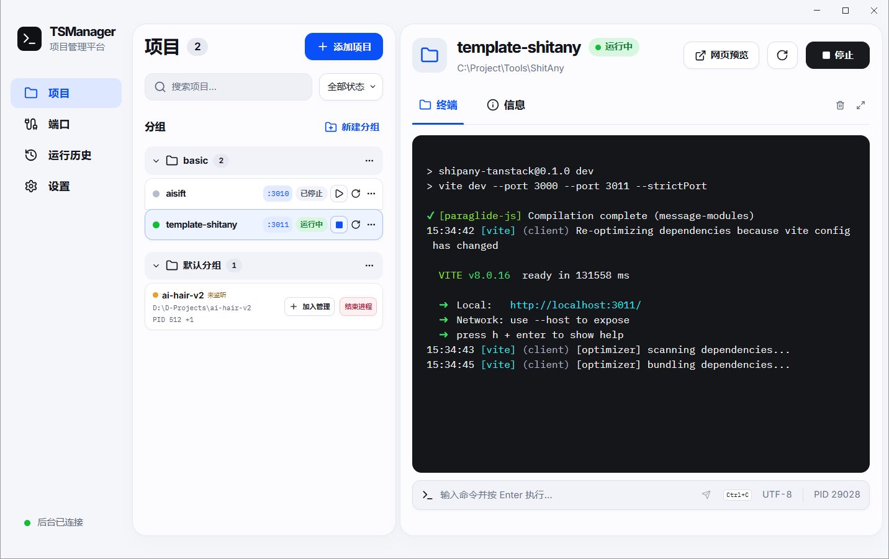

# TSManager

English · [简体中文](README.zh-CN.md)

TSManager is a Windows app for running and organizing local development projects. Add a project folder, choose a startup command, and use its dedicated terminal to read output and send input. TSManager can run npm, pnpm, Yarn, Python, or any custom command available on your system.



## Features

- **Project groups** organize local projects. Configure the startup command, shell, port, and environment variables for each project.
- **Dedicated terminals** stream live output and accept input, including `Ctrl+C` to interrupt a command.
- **Automatic discovery** finds unmanaged Node.js projects running in your Windows session. View their paths, process IDs, and listening ports, or import them into TSManager.
- **Port management** shows local TCP listeners and the processes that own them. TSManager checks for conflicts before startup and passes the configured port to recognized Vite commands.
- **Run history** keeps past runs, exit codes, and terminal logs.
- **System tray and web workspace** let projects keep running when the window is closed to the tray. Open the local web workspace in your browser to use the same project settings and live terminals.

## Install and use

1. On Windows 10 version 1809 or later (x64), run `release/TSManager-Setup-1.0.10-x64.exe`. You can build this unsigned, per-user installer with `npm run dist`.
2. Open **Projects → Add project**. Choose the folder, group, and shell, then enter a startup command such as `npm run dev`.
3. Set a port if the service needs one. TSManager checks whether the TCP port is in use before starting. For supported Vite commands, including single Vite scripts run through pnpm, npm, or Yarn, TSManager passes `--port` and `--strictPort` at launch. Custom commands can read the `PORT` environment variable.
4. Select **Run**. Type directly into **Terminal** or use the command field below it. Press `Ctrl+C` to interrupt the command. **Stop** cleans up the project's process tree if the command does not exit before the timeout.
5. Close the window to send TSManager to the system tray while projects continue running. Click the tray icon to restore the window, or right-click it and select **Quit TSManager**. Under **Settings → When quitting TSManager**, choose whether to stop all projects or keep them running. If you keep them running, TSManager reconnects to surviving sessions the next time it opens.
6. Select **Settings → Open web workspace** to open the same project settings and live terminals in your default browser. The web workspace listens on a local port and shuts down when the desktop app quits.
7. TSManager starts with the light theme. In **Settings → General**, preview the Light, Dark, or Classic theme and save your choice to apply it to both workspaces. Classic uses the previous light palette and layout. You can change the interface language in the same section.

The **Default group** lists unmanaged Node.js projects detected from each process's working directory and its nearest `package.json`. Select a project name to view its path, process IDs, and listening ports. Select a port under **Web preview** to open the corresponding local address in your browser. Projects without a listening port show an amber **Not listening** label. **Import project** pre-fills the project settings, and **End process** asks for confirmation before stopping the selected processes.

Install the runtimes and package managers your projects need and make them available on `PATH`. TSManager runs Windows PowerShell without a profile and sets the execution policy to Bypass for that project's shell process so it can run npm and pnpm command scripts.

TSManager stores projects, groups, terminal and process settings, run history, and logs in `%APPDATA%\TSManager\tsmanager.sqlite3`. The same directory contains `ui-language` and `ui-theme`. Upgrades and reinstalls reuse this data. Windows DPAPI encrypts environment variable values for the current Windows account. Enter those values again if you migrate to a different account.

If TSManager is still connected to an older background service when you start a Vite project, it upgrades the service once it is idle, then starts the project on the configured port. Stop any other running projects before retrying if they are keeping the old service active.

## Development and builds

Use Node.js 22.12 or later on Windows x64. Development dependencies are pinned in `package-lock.json`.

```powershell
npm ci
npm run dev
```

```powershell
npm run build
npm start
npm run dist
```

| Command | Purpose |
| --- | --- |
| `npm run dev` | Start Vite and Electron with hot reload for the interface |
| `npm run preview:web` | Open the local web workspace with access to projects and live terminals |
| `npm run build` | Run the TypeScript checks and build the main process and both interfaces |
| `npm start` | Run the built desktop app |
| `npm run dist` | Build the Windows x64 app and NSIS installer in `release/` |
| `npm test` | Test SQLite, PTYs, ports, and the process lifecycle in Electron's Node.js runtime |
| `npm run test:ui` | Drive an Electron window with Playwright and verify local services |
| `npm run test:web` | Test local web authentication, live PTY output and input, and replay after reconnecting |

The desktop app and the web workspace share project settings and the same PTY backend. When run from source, `npm run preview:web` listens on `127.0.0.1:5178` by default and opens an authorized browser page. Enter the full folder path when adding a project from the browser. The terminal displays output from instances launched by TSManager.

Automated tests use temporary data directories. The process tests require npm, pnpm, and Python on `PATH`. Set `TSMANAGER_TEST_EXE` to the packaged or installed `TSManager.exe` to test that build. For packaged process tests, also set `TSMANAGER_TEST_WORKER` to `resources\app.asar\build\worker.cjs` under the app directory.

For the upgrade regression test, extract `app.asar` and `app.asar.unpacked` from the 1.0.1 installer into the same directory. Set `TSMANAGER_TEST_LEGACY_WORKER` to the old `app.asar\build\worker.cjs`, build the current app, and run `node tests/upgrade.mjs`.

## Architecture

- `src/renderer` uses React, Vite, Tailwind CSS, Radix UI, Zustand, and xterm.js.
- `src/main/preload.ts` exposes a typed API through Electron's `contextBridge`. The renderer uses context isolation and sandboxing.
- `src/main/main.ts` manages windows, the native folder picker, and IPC.
- `src/main/worker.ts` manages SQLite, node-pty, Windows Job Objects, port scanning, and logs. The worker and main process communicate over a mutually authenticated local named pipe.
- SQLite runs through Electron's built-in `node:sqlite`. The packaged app includes the native modules needed for node-pty and Windows API bindings.

When stopping a project, TSManager sends `Ctrl+C` first. If the timeout expires, a Windows Job Object cleans up that project's process tree. If the worker exits unexpectedly, Windows closes the job handle and cleans up its processes. Port conflicts show the process that owns the port. Ending an external process requires confirmation. [Windows Job Objects](https://learn.microsoft.com/en-us/windows/win32/procthread/job-objects) · [node-pty](https://github.com/microsoft/node-pty)

PortPilot informed the design of the project list, port ownership, and process management workflows. TSManager implements its own application and data format. [PortPilot](https://github.com/m4cd4r4/PortPilot)

## Project documentation

The following documents are in Simplified Chinese.

- [Database schema](docs/database.md)
- [IPC reference](docs/ipc.md)
- [QA report](docs/qa.md)
