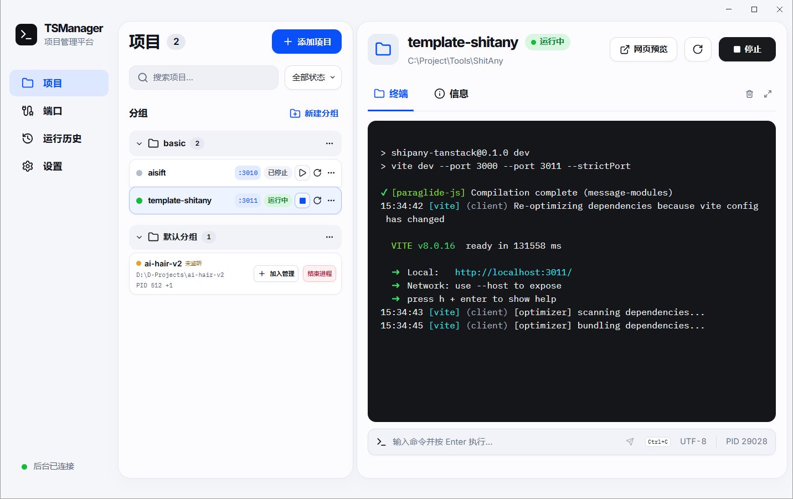

# TSManager

[English](README.md) · 简体中文

TSManager 是 Windows 本地开发项目运行管理器。把本地目录加入工作区后，可以按分组运行 npm、pnpm、Yarn、Python 或其他自定义命令，并在每个项目的独立终端里查看输出和输入命令。



## 功能介绍

- **项目分组**可整理本地项目，每个项目可单独配置启动命令、Shell、端口和环境变量。
- 每个项目都有**独立终端**，可以实时查看输出、输入命令，或按 `Ctrl+C` 中断命令。
- **自动发现**当前 Windows 会话中正在运行且尚未纳入管理的 Node.js 项目，显示路径、PID 和监听端口，并支持将其加入管理。
- **端口管理**可查看本机 TCP 监听端口及占用进程。启动前会检查端口占用，识别到的 Vite 命令会使用项目配置的端口。
- **运行历史**保留项目的运行记录、退出码和终端日志，方便回查。
- 窗口收起到**系统托盘**后，项目会继续运行。通过本机浏览器打开**网页工作区**，可访问同一份项目配置和实时终端。

## 安装与使用

1. 在 Windows 10 1809 或更新的 x64 系统上运行 `release/TSManager-Setup-1.0.10-x64.exe`。安装包为当前用户安装，签名状态为未签名。
2. 在 **项目 → 添加项目** 中选择项目目录、分组和 Shell，填写启动命令，例如 `npm run dev`。
3. 如果服务需要端口，在项目配置中填写端口。TSManager 在启动前检查 TCP 占用。识别为 Vite 的启动命令会收到配置的 `--port` 和 `--strictPort`，包括通过 pnpm、npm 或 Yarn 启动的单条 Vite 脚本。项目文件与保存的启动命令保留原值。自定义启动命令可以读取 `PORT` 环境变量。
4. 点击 **运行**，在 **终端** 中直接输入，或通过底部的快捷输入发送命令。`Ctrl+C` 向终端发送中断，**停止** 会在等待超时后清理项目进程树。
5. 点击窗口右上角的关闭按钮，TSManager 会收起到 Windows 右下角的系统托盘，运行中的项目会继续运行。单击托盘图标可恢复窗口，右键选择 **退出 TSManager** 可退出应用。退出时按 **设置 → 退出 TSManager 时** 的选项停止所有项目或保留后台项目。选择保留时，下次打开 TSManager 会重新连接存活的会话。
6. 在 **设置 → 打开网页工作区** 可以用默认浏览器连接同一份配置和实时终端。网页服务使用本机端口，在桌面应用退出时关闭。
7. 首次使用默认浅色主题。在 **设置 → 常规** 选择浅色、深色或经典可即时预览，保存后桌面和网页工作区会同步更新。经典使用旧版浅色配色和布局。界面语言也在此处设置。

**默认分组**会自动显示当前 Windows 会话中尚未添加的 Node.js 项目。识别以进程的工作目录及其最近的 `package.json` 为依据。点击项目名可查看路径、PID 和监听端口，点击详情中「网页预览」的端口可在浏览器打开对应的本地地址。没有监听端口时显示琥珀色「未监听」。**加入管理**可预填项目配置，**结束进程**会在确认后终止所选进程。

运行项目使用系统已经安装并加入 PATH 的 Node.js、包管理器、Python 等工具。Windows PowerShell 以无配置文件模式运行，脚本执行策略只在该项目 Shell 进程内设为 Bypass，以便运行 npm、pnpm 等命令脚本。

项目、分组、终端和进程设置、运行历史及日志保存在 `%APPDATA%\TSManager\tsmanager.sqlite3`。界面语言和经典主题偏好分别保存在同目录下的 `ui-language` 和 `ui-theme` 文件。覆盖安装和卸载后重装会继续使用这些数据。环境变量值由 Windows DPAPI 绑定到当前账号，跨账号迁移时需要重新录入变量。

如果 Vite 项目启动时仍连接着旧版后台，TSManager 会在后台空闲时自动切换到新版，再按配置端口启动。如果其他项目仍在运行，可在停止这些项目后重试。

## 开发与构建

在 Windows x64 上准备 Node.js 22.12 或更新版本。开发依赖通过 `package-lock.json` 锁定。

```powershell
npm ci
npm run dev
```

```powershell
npm run build
npm start
npm run dist
```

| 命令 | 用途 |
| --- | --- |
| `npm run dev` | 启动 Vite 与 Electron，支持界面热更新 |
| `npm run preview:web` | 打开本机网页工作区，连接真实项目与终端 |
| `npm run build` | 运行 TypeScript 类型检查并构建主进程和界面 |
| `npm start` | 运行已构建的桌面应用 |
| `npm run dist` | 构建 Windows x64 应用及 NSIS 安装包 |
| `npm test` | 在实际 Electron Node 运行时检查 SQLite、PTY、端口和进程生命周期 |
| `npm run test:ui` | 用 Playwright 操作真实 Electron 窗口并验证本地服务 |
| `npm run test:web` | 验证本机网页的鉴权、实时 PTY 输出、输入和重连回放 |

本机网页和桌面版使用同一项目配置与 PTY 后台。从源码运行 `npm run preview:web` 时，网页服务默认监听 `127.0.0.1:5178`，并打开已授权的浏览器页面。在网页添加项目时，请填写目录的完整路径。终端显示经 TSManager 启动的实例输出。

自动化测试使用临时数据目录。进程测试需要 npm、pnpm、Python 都可通过 PATH 调用。可用 `TSMANAGER_TEST_EXE` 指向打包或已安装的 `TSManager.exe`。进程测试打包版时同时设置 `TSMANAGER_TEST_WORKER`，指向该应用下的 `resources\app.asar\build\worker.cjs`。

升级回归测试需要从 1.0.1 安装包解出同目录下的 `app.asar` 和 `app.asar.unpacked`。将 `TSMANAGER_TEST_LEGACY_WORKER` 指向旧版的 `app.asar\build\worker.cjs`，构建后运行 `node tests/upgrade.mjs`。

## 实现结构

- `src/renderer` 使用 React、Vite、Tailwind CSS、Radix UI、Zustand 和 xterm.js。
- `src/main/preload.ts` 通过 contextBridge 暴露类型化接口。渲染进程启用隔离与沙箱。
- `src/main/main.ts` 管理窗口、原生文件夹选择器和受限 IPC。
- `src/main/worker.ts` 负责 SQLite、node-pty、Windows Job Object、端口扫描与日志。后台与主进程通过经双向认证的本机命名管道通信。
- SQLite 通过 Electron Node 运行时自带的 `node:sqlite` 访问。打包时只分发 node-pty 和 Windows API 绑定所需的本机模块。

停止时优先发送 Ctrl+C。超时后 Windows Job Object 只清理该项目的进程树。后台异常结束时，Windows 会关闭 Job 句柄并清理其中的进程。端口冲突会显示实际占用者，终止外部进程需在端口详情中明确确认。[Windows Job Object 文档](https://learn.microsoft.com/en-us/windows/win32/procthread/job-objects) · [node-pty](https://github.com/microsoft/node-pty)

项目列表、端口归属与进程管理流程参考了 `0-reference-PortPilot-master/` 中的 PortPilot 源码。TSManager 单独实现应用与数据格式。[PortPilot](https://github.com/m4cd4r4/PortPilot)

- [数据库结构](docs/database.md)
- [IPC 接口](docs/ipc.md)
- [QA 测试报告](docs/qa.md)
